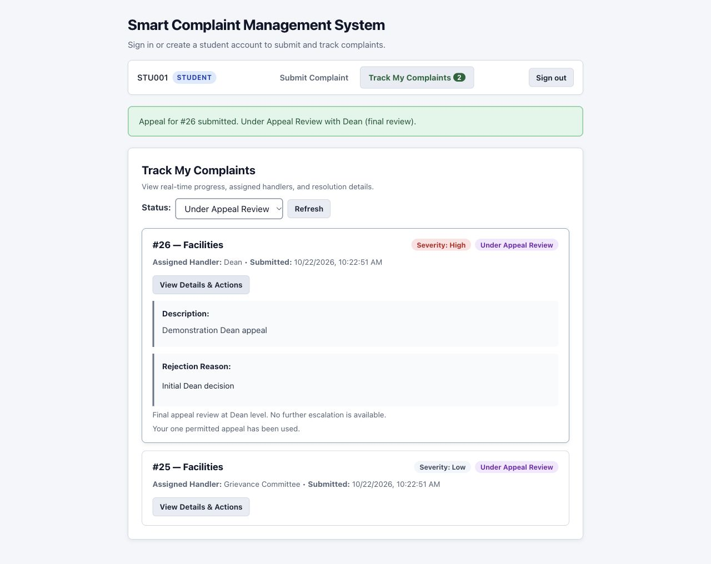
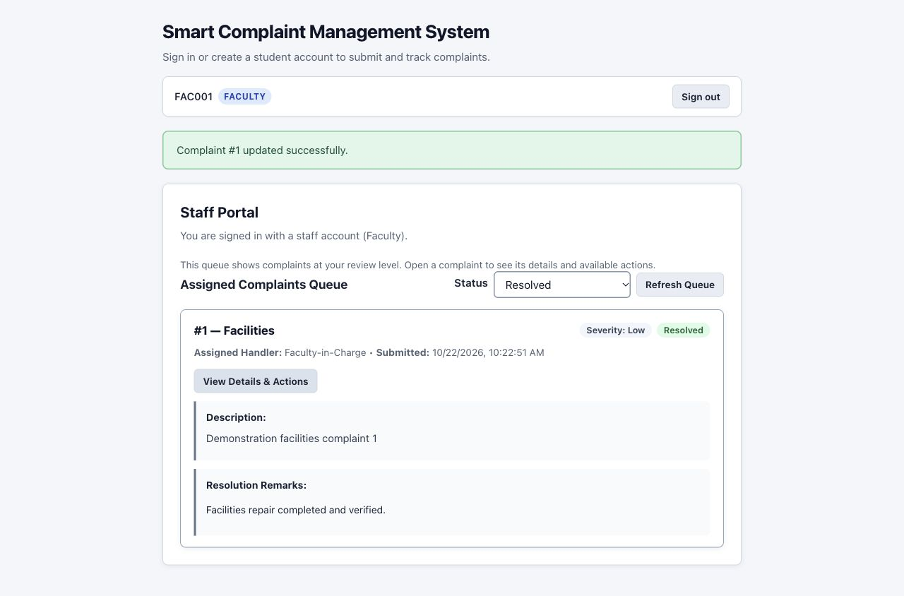
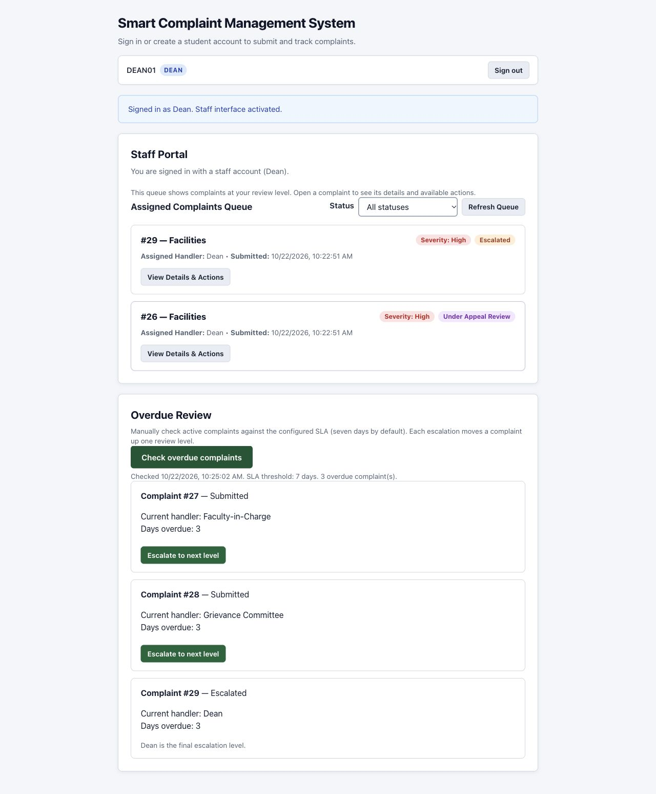
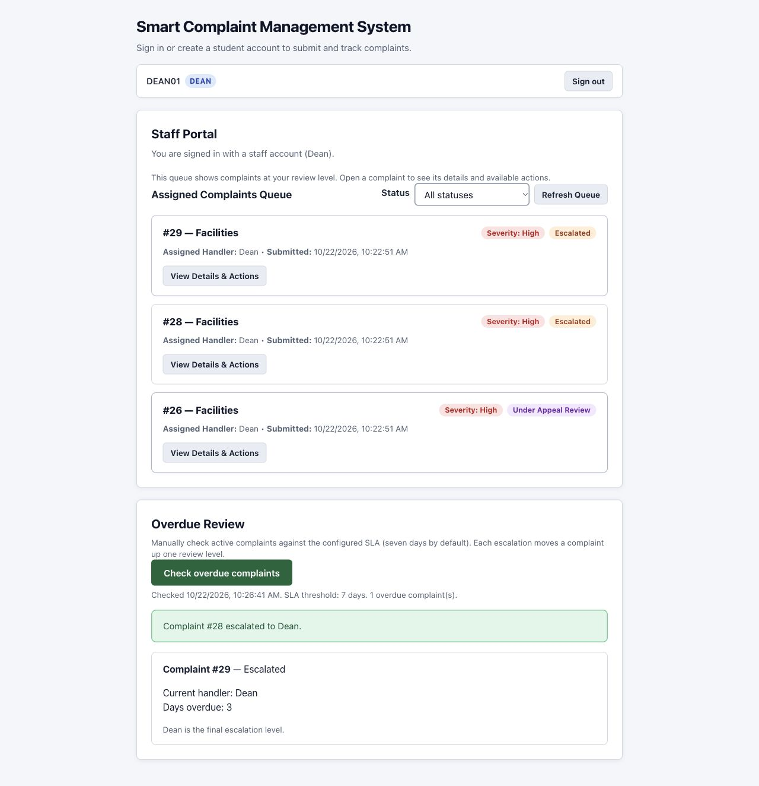

# Sprint 1 verification — issues #7, #8 and #9

Date: 22 October 2026

Project: Smart Complaint Management System

Implementation: Flask 3.1.3, Werkzeug 3.1.8, SQLite, browser JavaScript

## Acceptance coverage

| Issue | Delivered behavior | Evidence |
|---|---|---|
| #7 Role-specific dashboards (REQ-7.x) | Server-scoped queues, clear status and handler, status filters, ten-item pages, detail views and authorized staff actions | Automated role, filtering, pagination and performance checks; browser reached page 3 of a 26-item Faculty queue and resolved an item there |
| #8 Complaint appeals (REQ-5.x) | Required justification, one appeal per complaint, correct next review level, Dean final-review exception, stale-state recovery | Automated ownership, duplicate, rollback and routing checks; browser appealed Faculty and Dean rejections and verified their destinations |
| #9 SLA review (REQ-8.x) | Manual authorized check, configurable threshold with seven-day default, handler and days overdue, one-level escalation, version checks, Dean ceiling | Automated permission, boundary, terminal-state and audit checks; browser verified permission visibility, stale rejection, successful escalation and the Dean ceiling |

## Automated results

Run from the repository root:

```bash
python -m unittest discover -s tests -v
node --check scms/static/app.js
git diff --check
```

The application suite passes **68 tests**: the existing 55 tests plus 13 sprint
regressions in `tests/test_sprint_workflows.py`. The JavaScript syntax and whitespace
checks also pass. The [test transcript](test-results.txt) records the application run.

New regression scenarios cover:

1. Effective SLA permission in login and restored sessions for all roles.
2. Logout, fresh CSRF bootstrap and login as a different user.
3. Permission revocation during an existing session.
4. Rejection of a non-Dean account even if its SLA flag is set.
5. Complete three-page results, ownership/queue boundaries and status filtering.
6. Dashboard responses below two seconds with 250 complaints spanning all review levels.
7. Faculty rejection, student appeal, queue transfer and second-appeal rejection.
8. Stale appeal rejection without partial writes.
9. Dean rejection reopened as a final review, with no further escalation.
10. Versioned SLA escalation without general access to lower-level complaint details.
11. Stale SLA escalation rejection without a second transition or audit write.
12. Configured three-day SLA and strict threshold boundary.
13. CSRF protection and read-only behavior of the manual SLA check.

The performance scenario makes five sequential page requests for each of Student,
Faculty, Committee and Dean against a temporary SQLite database. Each queue is
nonempty. This verifies local response time; it does not establish concurrent
production capacity or a browser rendering/network SLA under a specified workload.

## Browser verification

Used a local instance with an isolated temporary database and sample records.
No production complaint records or real account credentials were used.

| Scenario | Observed result |
|---|---|
| Student rejected filter and blank appeal | Only matching complaints shown; blank justification blocked with focus on the input |
| Stale appeal | Conflict displayed; fresh details loaded; justification preserved; explicit retry succeeded |
| Faculty-level appeal | Reopened at Committee with Under Appeal Review status |
| Dean-level appeal | Stayed with Dean for final review; used-appeal notice shown; no second appeal control |
| Faculty pagination and actions | Third page reachable; required remarks validated; resolution and filtered status visible |
| Unauthorized Dean | Standard Dean queue visible; SLA panel hidden |
| Authorized Dean reload | Account identity and SLA permission restored; no overdue check ran until the button was pressed |
| Manual SLA check | Seven-day threshold, current handlers, days overdue and Dean ceiling displayed |
| Stale SLA action | No transition; old results cleared and a fresh check required |
| Fresh SLA action | One-level escalation succeeded; SLA results and Dean queue refreshed |
| Existing feedback | Student submitted once and subsequently saw the stored rating/comment |
| Session expiry and account switch | Private views cleared, sign-in restored, next student saw only their complaint |

For stale-state checks, the version was advanced directly in the isolated fixture
database after the browser loaded the old version. This simulates another writer;
the automated suite separately checks real role-driven transitions.

Screenshots show sample data:









## Scope and limitations

The existing role model has Student, Faculty, Committee and Dean accounts; no
separate Admin role is introduced. SLA permission is restricted to a Dean with the
explicit provisioning flag. Threshold configuration remains a trusted database
setting. Resolved and rejected complaints are excluded from active overdue review.
No database migration or new dependency is required.

The work is prepared for team review on a feature branch. Release and shared
deployment acceptance remain separate from this local verification.
